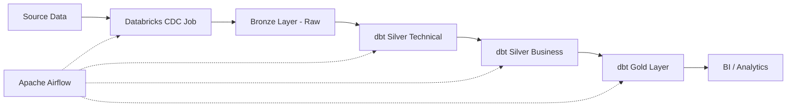

# 🛒 Enterprise Retail Analytics Transformation Pipeline

This project is a professional-grade data engineering implementation designed to process retail data for Walmart. It demonstrates a complete **Modern Data Stack (MDS)** utilizing a **Medallion Architecture** to move data from raw ingestion to business-ready analytics, enabling data-driven decision making across the retail ecosystem.

## 📖 Table of Contents

- [Project Overview](#project-overview)
- [Business Use Cases](#business-use-cases)
- [System Architecture](#system-architecture)
- [Data Pipeline Design (Medallion Architecture)](#data-pipeline-design)
- [Component Deep Dive](#component-deep-dive)
  - [Orchestration (Apache Airflow)](#orchestration-apache-airflow)
  - [Transformation (dbt)](#transformation-dbt)
  - [Compute (Databricks/Delta Lake)](#compute-databricksdelta-lake)
- [Workflow Execution](#workflow-execution)
- [Detailed Project Structure](#detailed-project-structure)
- [Deployment &amp; Installation Guide](#deployment--installation-guide)
- [Data Quality &amp; Testing Strategy](#data-quality--testing-strategy)
- [Troubleshooting](#troubleshooting)

---

## 🎯 Project Overview

The **Enterprise** **Retail Analytics Transformation Pipeline** is an end-to-end ELT system that automates the flow of data from raw source systems into a curated analytics warehouse. By leveraging **Apache Airflow** for orchestration and **dbt** for transformation on **Databricks**, the project converts fragmented retail data into trusted, high-performance datasets.

**Core Objective:** To replace manual reporting processes with an automated, governed, and scalable pipeline that provides a "Single Source of Truth" for Walmart's retail operations.

---

## 💼 Business Use Cases

This pipeline is engineered to support several critical business functions:

### 📈 Retail Performance Monitoring

- **Objective:** Track sales, revenue, store productivity, and product performance across all Walmart locations.
- **Value:** Provides leadership with real-time visibility into daily, weekly, and monthly business KPIs to drive strategic adjustments.

### 📦 Inventory and Demand Planning

- **Objective:** Analyze orders, products, and store-level demand to optimize replenishment strategies.
- **Value:** Reduces costly stockouts and minimizes excess inventory by identifying regional and seasonal buying patterns.

### 👥 Customer and Sales Insights

- **Objective:** Study customer behavior, purchasing frequency, and product affinity.
- **Value:** Supports advanced customer segmentation, allowing for highly targeted promotions and personalized marketing campaigns.

### ⚙️ Operational Reporting

- **Objective:** Consolidate disparate data from sales, employees, orders, and stores into unified analytics tables.
- **Value:** Enables Finance, Supply Chain, and Operations teams to align on a single set of numbers, eliminating data silos.

### 🔮 Forecasting and Trend Analysis

- **Objective:** Leverage historical sales and order data for predictive modeling.
- **Value:** Supports better planning for seasonal promotions, staffing requirements, and strategic product allocation.

### 🤖 Data Pipeline Automation

- **Objective:** Remove manual intervention from the ETL process via Airflow.
- **Value:** Increases data reliability, reduces human error, and ensures that reports are updated automatically before the business day begins.

### 🏛️ Analytics-Ready Warehouse Modeling

- **Objective:** Implement a governed layer-based model (Source $\rightarrow$ Silver $\rightarrow$ Gold).
- **Value:** Ensures that downstream BI dashboards (PowerBI/Tableau) are consistent, clean, and performant.

---

## 🏗️ System Architecture

The system is built on a decoupled architecture where orchestration, transformation, and compute are handled by specialized tools:



### Tech Stack Summary

| Layer                     | Tool                    | Purpose                                                          |
| :------------------------ | :---------------------- | :--------------------------------------------------------------- |
| **Orchestration**   | Apache Airflow          | DAG scheduling, dependency management, and monitoring.           |
| **Transformation**  | dbt (data build tool)   | SQL-based transformations, documentation, and testing.           |
| **Compute/Storage** | Databricks / Delta Lake | High-performance distributed compute and ACID-compliant storage. |
| **Environment**     | Docker                  | Containerization for consistent deployment.                      |

---

## 🌊 Data Pipeline Design (Medallion Architecture)

We implement the Medallion Architecture to ensure data is refined as it flows through the system.

### 1. Bronze Layer (Raw/Ingestion)

- **Process**: CDC (Change Data Capture) ingestion.
- **State**: Raw data exactly as it appears in the source.
- **Handled by**: Databricks Jobs triggered by Airflow.

### 2. Silver Layer (Cleansing & Logic)

The Silver layer is split into two distinct phases:

- **Silver Technical (`silver_t`)**:
  - Focuses on **Data Engineering**.
  - Performs type casting, null handling, and renaming.
  - Materialized as **Tables** for performance.
- **Silver Business (`silver_b`)**:
  - Focuses on **Business Intelligence**.
  - Implements the **OBT (One Big Table)** pattern.
  - Joins multiple technical tables into a single wide table (`obt_b`) for analyst consumption.

### 3. Gold Layer (Curated/Reporting)

- **Ephemeral Models**: Temporary views used for complex intermediate calculations (e.g., `eph_customers`).
- **Dimensions**: Maintained via **dbt Snapshots** to track changes over time (SCD Type 2).
- **Facts**: Final aggregate tables (e.g., `fact_orders`) optimized for BI tool queries.

---

## 🔍 Component Deep Dive

### Orchestration (Apache Airflow)

The `orchestrate` DAG serves as the brain of the project. It manages a linear dependency chain:
`Ingest CDC` $\rightarrow$ `Clean Target` $\rightarrow$ `Source Freshness` $\rightarrow$ `Silver Technical` $\rightarrow$ `Silver Technical Tests` $\rightarrow$ `Silver Business` $\rightarrow$ `Silver Business Tests` $\rightarrow$ `Gold Ephemeral` $\rightarrow$ `Gold Dimensions (Snapshots)` $\rightarrow$ `Gold Facts`.

### Transformation (dbt)

We utilize advanced dbt features:

- **Jinja Templating**: The `obt_b.sql` model uses a dynamic Jinja loop to construct joins, making the code maintainable and DRY (Don't Repeat Yourself).
- **Materializations**:
  - `Table`: For heavy Silver/Gold models.
  - `Ephemeral`: For intermediate Gold models.
  - `Snapshot`: For historical dimension tracking.
- **Custom Macros**: `custom_schema.sql` is used to manage environment-specific schema routing.

### Compute (Databricks/Delta Lake)

The project leverages Delta Lake's capabilities for:

- **ACID Transactions**: Ensuring data consistency during concurrent writes.
- **Time Travel**: Allowing the system to query previous versions of data.
- **Scalability**: Handling large Walmart datasets using Spark clusters.

---

## 🔄 Workflow Execution

1. **CDC Trigger**: Airflow uses the `WorkspaceClient` from the Databricks SDK to run a specific job ID. It polls the API until the job reaches a `TERMINATED` state.
2. **Environment Reset**: `clean_target` ensures no stale artifacts from previous dbt runs exist.
3. **Freshness Check**: `dbt source freshness` ensures that the data in the Bronze layer is current before proceeding.
4. **Incremental Build**: The pipeline builds Silver $\rightarrow$ Gold, ensuring that tests pass at the Silver level before any Gold models are updated.

---

## 📂 Detailed Project Structure

```text
.
├── airflow_dbt_project/
│   ├── config/airflow.cfg          # Airflow system settings
│   ├── dags/
│   │   └── orchestrate.py          # The Master DAG logic
│   ├── walmart_project/            # dbt Project Root
│   │   ├── dbt_project.yml         # Project config & Materialization settings
│   │   ├── profiles.yml            # Connection details for Databricks
│   │   ├── models/
│   │   │   ├── source/             # sources.yml (Defines raw tables)
│   │   │   ├── silver_t/           # Technical cleaning SQL files
│   │   │   ├── silver_b/          # Business OBT logic (obt_b.sql)
│   │   │   └── gold/               # Final reports & Ephemeral models
│   │   ├── snapshots/              # SCD Type 2 Dimension definitions
│   │   └── macros/                # custom_schema.sql
│   ├── Dockerfile                  # Custom image with dbt & Databricks SDK
│   └── docker-compose.yaml         # Full Airflow cluster (Web, Scheduler, Worker, Postgres, Redis)
└── walmart_dataset/                # Seed data for local setup
    ├── data/*.csv                  # Sample retail data
    └── ddl/walmart_schema.sql      # Database initialization script
```

---

## 🚀 Deployment & Installation Guide

### 1. Initial Database Setup

Before starting the pipeline, load the seed data:

```bash
cd walmart_dataset
python load_data.py
```

### 2. Environment Configuration

Create an `.env` file in `airflow_dbt_project/`:

```env
FERNET_KEY=your_generated_fernet_key
AIRFLOW__API_AUTH__JWT_SECRET=your_jwt_secret
AIRFLOW_PROJ_DIR=.
```

### 3. Databricks Integration

Update `airflow_dbt_project/dags/orchestrate.py`:

- Set `host`, `token`, and `job_id` in the `ingest_cdc` task.

### 4. Launching the Infrastructure

```bash
cd airflow_dbt_project
docker-compose up --build -d
```

- **Airflow UI**: `http://localhost:8080`
- **Credentials**: `airflow` / `airflow`

---

## ✅ Data Quality & Testing Strategy

We employ a "Test-Early, Test-Often" approach:

1. **Source Freshness**: Detects if data ingestion has stalled.
2. **Generic Tests**: In `properties.yml`, we define `not_null` and `unique` constraints for critical IDs (e.g., `product_id`, `order_id`).
3. **Singular Tests**: Custom SQL tests in `tests/test_obt.sql` to validate complex business logic.
4. **Layered Validation**: The Airflow DAG explicitly separates `silver_technical` and `silver_technical_tests`, preventing bad data from reaching the Gold layer.

---

## 🛠️ Troubleshooting

| Issue                      | Cause                    | Resolution                                                    |
| :------------------------- | :----------------------- | :------------------------------------------------------------ |
| `ingest_cdc` fails       | Databricks Token expired | Update token in`orchestrate.py`.                            |
| `dbt run` errors         | Profile mismatch         | Verify`profiles.yml` matches Databricks workspace settings. |
| Docker container crashes   | Resource exhaustion      | Increase Docker Desktop RAM to at least 4GB.                  |
| `source_freshness` fails | CDC Job not running      | Manually trigger the Databricks Job and check logs.           |
